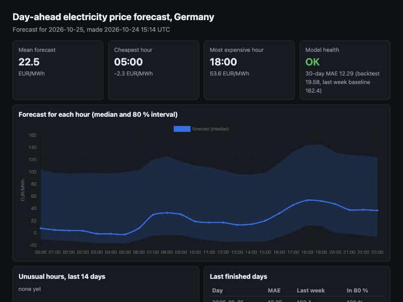
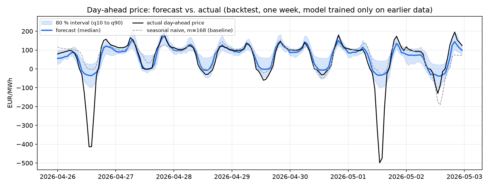
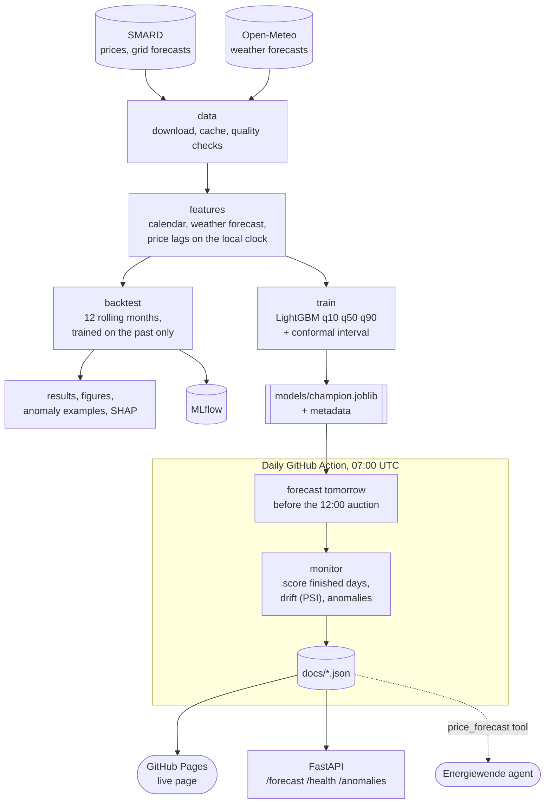
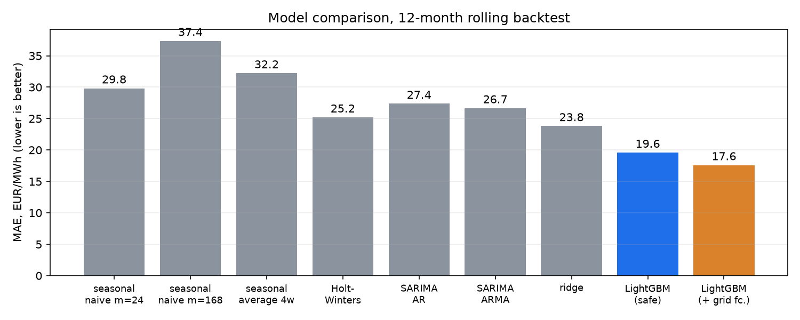
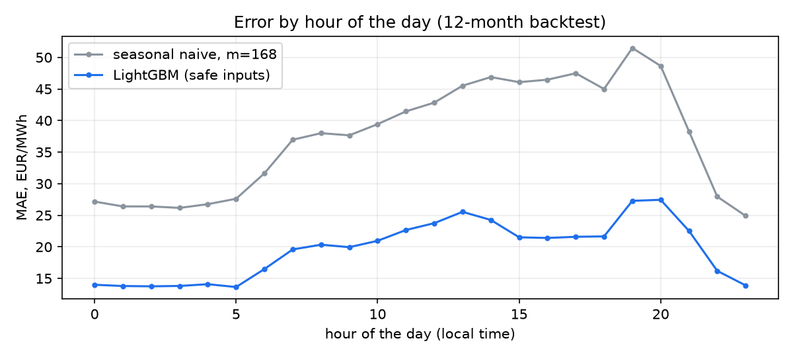
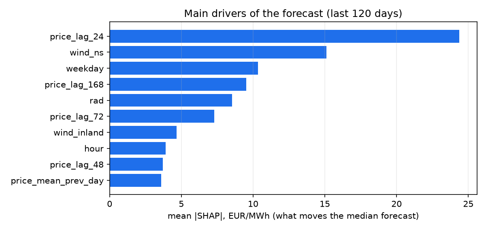

# Energy Price Forecast: German day-ahead electricity prices


**Result:** a LightGBM model forecasts tomorrow's 24 hourly day-ahead prices for Germany with an **MAE of 19.6 EUR/MWh:
22.3 % lower than the best classical baseline (Holt-Winters exponential smoothing, 25.2) and 47.6 % lower than the seasonal naive
forecast with m = 168 (37.4)**, over a 12-month rolling backtest in which every month is forecast by a
model trained only on earlier data. The 80 % prediction interval really contains **79 %** of the actual prices.
A GitHub Action forecasts the next day every morning and scores the finished days, so the live page cannot go stale or
offline: **[live page](https://omercan4.github.io/energy-price-forecast/)** (GitHub Pages, updated daily).





## The task, stated precisely

> Predict the 24 hourly day-ahead prices (DE-LU) of day D, using only what is known before the auction at 12:00 on day D-1.

That sentence decides which inputs are allowed. The prices of day D-1 are known, those of day D are not. Weather *forecasts*
for day D are known, measured weather is not. The tests check that changing the prices of day D does not change
a single feature of day D (`tests/test_features.py`).

## Learn how it works: the notebook

[`notebooks/01_end_to_end_walkthrough.ipynb`](notebooks/01_end_to_end_walkthrough.ipynb) walks through the whole process in 10 sections, with the
reasoning at every step and the outputs already saved (GitHub shows them without running anything): the task and what is allowed to be known,
the data, leakage-free features (with a live leakage test and the 25-hour-day trap), baselines, the quantile model, interval calibration step by
step, the rolling backtest, SHAP, anomalies, and release and monitoring. It uses the real `epf` package, so it shows exactly what the daily job runs.
To run it yourself: `pip install -e ".[research,notebook]"`, `make data`, then `make notebook`.

## Architecture



## What is in the repository

| Part | What it does |
| --- | --- |
| `src/epf/data/` | Downloads SMARD prices and grid forecasts and Open-Meteo weather forecasts, caches them, checks data quality |
| `src/epf/features.py` | Calendar, weather forecast and price-history features. Lags follow the *local* clock (daylight saving safe) |
| `src/epf/backtest.py` | Rolling-origin backtest: each month is forecast by a model trained on earlier data only |
| `src/epf/models/` | Statistical baselines (seasonal naive, seasonal average, Holt-Winters, SARIMA), ridge regression, LightGBM quantile models with conformal interval calibration |
| `src/epf/anomaly.py` | Unusual hours: robust z-score of the forecast error per hour of day, compared with an Isolation Forest |
| `src/epf/monitor.py` | After release: rolling error vs. backtest, input drift (PSI), alerts |
| `src/epf/serve/` + `docs/index.html` | FastAPI and the web page (the same page is served by GitHub Pages) |
| `.github/workflows/daily.yml` | Daily forecast and monitoring, results committed to `docs/` |
| `MODEL_CARD.md` | Intended use, data, limits |

## Results (12-month backtest, 8,760 hours, 1 Oct 2025 to 30 Sep 2026)



Statistical baselines are named as in the forecasting literature. All of them are refitted for every day on the last 28 days
and only see prices before that day, so they know exactly as much as the machine learning model.
"m" is the season length in hours: m = 24 is a daily season, m = 168 a weekly season.

| Model | MAE | RMSE | sMAPE % |
| --- | --- | --- | --- |
| seasonal naive, m = 24 (the price of the same hour yesterday) | 29.8 | 47.3 | 45.2 |
| seasonal naive, m = 168 (the price of the same hour last week) | 37.4 | 57.5 | 52.7 |
| seasonal average, 4 weeks (mean of the same hour over the last 4 weeks) | 32.2 | 46.6 | 44.8 |
| Holt-Winters exponential smoothing, ETS(A,N,A), m = 24 | 25.2 | 39.1 | 39.1 |
| SARIMA(1,0,0)(1,1,0)24 (AR(1) + seasonal AR(1)) | 27.4 | 43.8 | 41.8 |
| SARIMA(1,0,1)(0,1,1)24 (ARMA(1,1) + seasonal MA(1)) | 26.7 | 41.6 | 40.3 |
| ridge regression (AR lags, weather forecasts, calendar) | 23.8 | 34.5 | 37.4 |
| **LightGBM, safe inputs (released model)** | **19.6** | **31.3** | **32.3** |
| LightGBM + grid operators' forecasts (reference only) | 17.6 | 28.8 | 31.7 |

The best classical baseline is Holt-Winters; the released model is **22.3 % better than it** (19.6 vs. 25.2). Against the
weakest baseline, the seasonal naive forecast with m = 168, the gain is 47.6 %. The first number is the honest one to quote,
because a model should be compared with the best simple alternative, not the worst.

MAPE is not used because prices are often near zero or negative (1,862 negative-price hours in the data).
The error is lower in winter (13.8) than in autumn (23.1), and it is highest in the evening (19:00 to 20:00) and around midday (12:00 to 14:00), when solar power makes prices swing.



**Prediction interval (80 %, q10 to q90).** The raw quantile models were too confident: their interval contained only
**69.5 %** of the actual prices. Conformalized quantile regression (the last 60 training days are held back to measure
how much wider the interval has to be) fixes this: coverage is now **79.0 %**, at the price of a wider interval
(mean width 52 to 61 EUR/MWh).

**What moves the forecast** (mean |SHAP| of the median model, `docs/img/shap.png`): yesterday's price at the same hour,
the wind forecast at the North Sea, the weekday, the price of the same hour last week (the lag at 168 hours) and solar radiation.



## What did not work, or is limited

- **The best model cannot be released.** Adding the grid operators' day-ahead forecasts for load, wind and solar lowers the MAE from
  19.6 to 17.6. But when I checked the live data, the wind and solar forecasts for tomorrow are not published yet in the
  morning, only the load forecast is. So the released model uses weather forecasts, calendar and price history; the version with
  grid forecasts is reported as a reference.
- **Weather in training is the "historical forecast" archive of Open-Meteo,** which stitches together the first hours of past
  model runs. The real lead time on the morning before is longer, so the live error can be a little higher than the backtest.
- **The anomaly detector is not clearly better than a simple one.** It flags hours whose forecast error is large for that hour of the
  day (robust z at least 4). Compared with reference events (negative prices and the top 1 % of prices),
  its precision is 0.52 and recall 0.12; an Isolation Forest that sees the price itself gets 0.64 and 0.15 at the same
  flag rate. The two answer different questions: the Isolation Forest finds extreme prices, the residual detector finds
  surprises given the conditions. Example hours with a plain-language reason are in `docs/anomaly_examples.json`.
- **Bugs I found by testing the 25-hour day** (clocks go back on 25 Oct 2026): the lag "same local hour yesterday" was shifted by one hour
  after a clock change, and for the last hour it looked into the day being forecast. Lags are now computed on the local clock
  and covered by tests.
- No fuel or CO2 prices are used (no free, reliable daily source), and the model sees one market (DE-LU).
- Not tried: a zero-shot time-series foundation model as an extra baseline, and SARIMA with exogenous regressors (SARIMAX). The ridge
  regression is the closest thing to an ARX model here: autoregressive lags plus exogenous inputs.

## Run it

```bash
python3.12 -m venv .venv && .venv/bin/pip install -e ".[research,dev]"
make data        # downloads ~4.5 years of data (a few minutes, then cached)
make backtest    # the 12-month backtest, figures in docs/img, MLflow run in mlflow.db
make train       # final model in models/
make forecast    # tomorrow's forecast in docs/forecast.json
make monitor     # score finished days, drift, anomalies
make serve       # http://127.0.0.1:8000 (page) and /docs (API)
make test
```

MLflow: `.venv/bin/mlflow ui --backend-store-uri sqlite:///mlflow.db` shows the runs (experiment *energy-price-forecast*).

API (`/docs` has the details): `GET /forecast`, `GET /forecast/{day}`, `GET /anomalies`, `GET /health`, `GET /history`.

```bash
docker build -t energy-price-forecast . && docker run -p 8000:8000 energy-price-forecast
```

## How the daily job works

`daily.yml` runs at 07:00, 08:00 and 09:30 UTC (before the auction at 12:00 CET, in summer and in winter). It makes tomorrow's forecast
(skipped if it exists, so retries are harmless), fetches the published prices of finished days, writes the rolling error, the drift
numbers and the anomaly list, and commits the JSON files in `docs/`. GitHub Pages serves them. The model file is stored in `models/`;
retrain with `make train` when the health box shows an alert.

## Data and licenses

| Data | Source | License |
| --- | --- | --- |
| Day-ahead prices, grid forecasts | Bundesnetzagentur \| SMARD.de | CC BY 4.0 |
| Weather forecasts | Open-Meteo.com | CC BY 4.0 (free API for non-commercial use) |

Code: MIT. A `secret-scan` workflow (gitleaks) checks the full git history for API keys and tokens on every push and once a week. Keys live only in `.env`, which is git-ignored. This project is for learning and demonstration. It is not trading advice.

## Next steps

Fuel and CO2 prices as inputs; a second market (Austria, Netherlands); retraining by a scheduled job when the health box shows an alert;
the same model as a tool for the [Energiewende agent](https://github.com/Omercan4/energiewende-agent), which then answers "What will the price tomorrow?".
